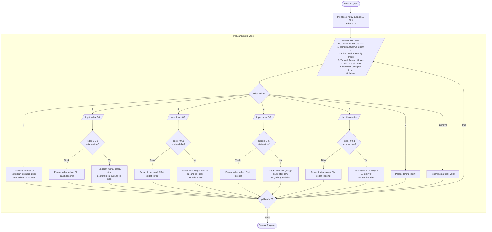

# Mini Projek Praktikum C++: Manajemen 10 Slot Gudang (Direct Index CRUD)

> **Mata Kuliah:** Algoritma dan Pemrograman / Dasar Pemrograman  
> **Cakupan Materi:** Variabel, Operator, Struct, Looping (`for` & `do-while`), Branching (`if-else`), dan Array 1D & Index.

---

## Deskripsi Masalah

Gudang Logistik Mahasiswa UNEJ memiliki sebuah rak penyimpanan yang terdiri dari **10 slot tetap** dengan nomor **Index `0` sampai `9`**. Pengelola gudang membutuhkan program CLI sederhana berbasis **Index Array** untuk mengecek semua slot, melihat detail satu slot tertentu, menambah bahan ke slot kosong, mengedit data di slot yang terisi, dan mengosongkan (delete) slot.

---

## Pemetaan Materi

| Materi | Implementasi di Program |
| :--- | :--- |
| **Variabel, Tipe Data, Operator** | Menyimpan input `index`, menghitung total nilai barang (`harga * stok`), dan validasi rentang index (`index >= 0 && index <= 9`). |
| **Struct (1 Struct Saja)** | Menggunakan `struct Bahan` dengan penanda `bool terisi` untuk mengetahui apakah slot sedang kosong atau berisi barang. |
| **For Loop** | Menampilkan daftar seluruh slot gudang dari index `0` sampai `9`. |
| **Do-While Loop** | Menjalankan **Menu Utama** secara terus-menerus hingga pengguna memilih `0` (Keluar). |
| **Branching (`if-else` & `switch-case`)** | Navigasi menu (`switch-case`), serta mengecek apakah `gudang[index].terisi` bernilai `true` atau `false` (`if-else`). |
| **1D Array & Index** | Mengakses, menambah, mengubah, dan menghapus data langsung melalui `gudang[index]`. |

---

## Struktur Data yang Digunakan

Program ini hanya menggunakan **1 `struct`** dan **1 Array 1D** berukuran 10 slot (`index 0 - 9`):

```cpp
#include <iostream>
#include <string>
using namespace std;

// Struct tunggal untuk merepresentasikan 1 slot di gudang
struct Bahan {
    string nama;
    int harga;
    int stok;
    bool terisi; // true = ada barang, false = slot kosong
};

int main() {
    // Array 1D untuk 10 slot gudang (Index 0 sampai 9)
    // Inisialisasi awal: semua slot diset kosong (false), lalu isi 2 contoh slot
    Bahan gudang[10] = {}; 

    gudang[0] = {"Beras_5Kg", 65000, 10, true};
    gudang[2] = {"Minyak_1L", 16000, 20, true};

    // ... kode menu do-while ...
}
```

---

## Diagram Alur Program (Flowchart)



---

## Rincian Menu & Alur Kerja (Flow)

> **Catatan Penting Validasi Index:**  
> Pada Menu 2, 3, 4, dan 5, program wajib mengecek apakah `index >= 0 && index <= 9` terlebih dahulu agar tidak terjadi *Out of Bounds*!

### 1. Tampilkan Semua Data (Read All)
* Menggunakan perulangan `for (int i = 0; i < 10; i++)`.
* Jika `gudang[i].terisi == true`, cetak `[Index i] Nama | Harga | Stok`.
* Jika `gudang[i].terisi == false`, cetak `[Index i] --- KOSONG ---`.

### 2. Lihat Data by Index (Read by Index)
* Meminta input `index` (`0`–`9`).
* Jika `gudang[index].terisi == true`, tampilkan detail lengkap bahan pada index tersebut beserta hasil kali `harga * stok`. Jika `false`, beri tahu bahwa slot tersebut kosong.

### 3. Tambah Data di Index (Create by Index)
* Meminta input `index` (`0`–`9`) tempat barang ingin ditaruh.
* Cek apakah slot kosong (`gudang[index].terisi == false`). Jika sudah ada isinya, tolak dan minta pilih slot lain atau gunakan menu Edit.
* Jika kosong, minta input `nama`, `harga`, `stok`, lalu ubah `gudang[index].terisi = true`.

### 4. Edit Data di Index (Update by Index)
* Meminta input `index` (`0`–`9`) yang ingin diedit.
* Cek apakah slot berisi data (`gudang[index].terisi == true`).
* Jika ada isinya, timpa `gudang[index].nama`, `gudang[index].harga`, dan `gudang[index].stok` dengan input yang baru.

### 5. Delete Data di Index (Delete by Index)
* Meminta input `index` (`0`–`9`) yang ingin dihapus.
* Cek apakah slot berisi data (`gudang[index].terisi == true`).
* Jika ya, kosongkan kembali slot tersebut cukup dengan mengubah:
  ```cpp
  gudang[index].nama = "";
  gudang[index].harga = 0;
  gudang[index].stok = 0;
  gudang[index].terisi = false;
  ```

---

## 💻 Contoh Simulasi Output (Output Flow)

### 1. Tampilkan Semua Data (Menu 1)
```text
========================================
   MANAJEMEN GUDANG (10 SLOT: IDX 0-9)
========================================
1. Tampilkan Semua Data (Index 0-9)
2. Lihat Data by Index
3. Tambah Data di Index
4. Edit Data di Index
5. Delete Data di Index
0. Keluar
========================================
Pilih menu: 1

--- DAFTAR SLOT GUDANG (INDEX 0 - 9) ---
[Index 0] Beras_5Kg   | Rp65000 | Stok: 10
[Index 1] --- KOSONG ---
[Index 2] Minyak_1L   | Rp16000 | Stok: 20
[Index 3] --- KOSONG ---
[Index 4] --- KOSONG ---
[Index 5] --- KOSONG ---
[Index 6] --- KOSONG ---
[Index 7] --- KOSONG ---
[Index 8] --- KOSONG ---
[Index 9] --- KOSONG ---
```

### 2. Lihat Data by Index (Menu 2)
```text
Pilih menu: 2

--- LIHAT DETAIL BY INDEX ---
Masukkan Index Slot (0-9): 2
>> Detail Index [2]:
   Nama Bahan  : Minyak_1L
   Harga Satuan: Rp16000
   Jumlah Stok : 20
   Total Nilai : Rp320000
```

### 3. Tambah Data di Index (Menu 3)
```text
Pilih menu: 3

--- TAMBAH DATA DI INDEX ---
Masukkan Index Slot tujuan (0-9)  : 1
Masukkan Nama Bahan (tanpa spasi) : Gula_1Kg
Masukkan Harga (Rp)               : 15000
Masukkan Stok                     : 25
>> Berhasil! Data disimpan pada Gudang Index [1].
```

### 4. Edit Data di Index (Menu 4)
```text
Pilih menu: 4

--- EDIT DATA DI INDEX ---
Masukkan Index Slot yang ingin diedit (0-9): 0
Data lama di Index [0] -> Beras_5Kg (Rp65000, Stok: 10)

Masukkan Nama Baru  : Beras_Premium_5Kg
Masukkan Harga Baru : 72000
Masukkan Stok Baru  : 15
>> Berhasil! Data pada Index [0] telah diperbarui.
```

### 5. Delete Data di Index (Menu 5)
```text
Pilih menu: 5

--- DELETE DATA DI INDEX ---
Masukkan Index Slot yang ingin dihapus (0-9): 2
>> Berhasil! Data "Minyak_1L" pada Index [2] telah dihapus (Slot kembali KOSONG).
```